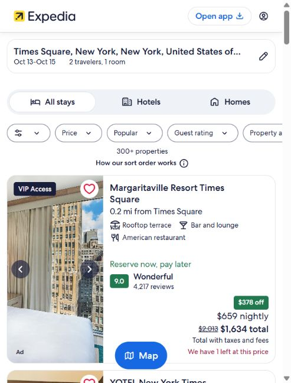
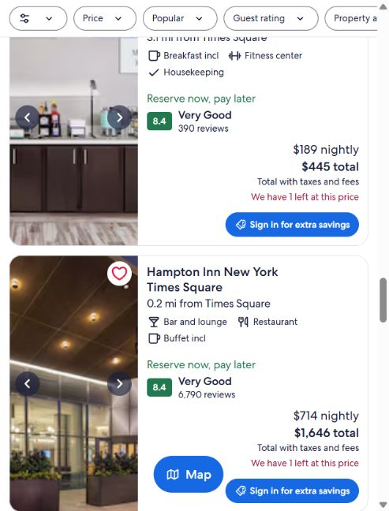
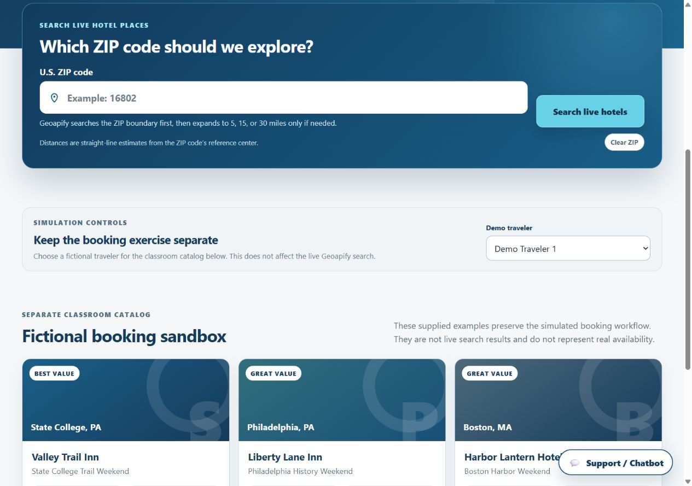
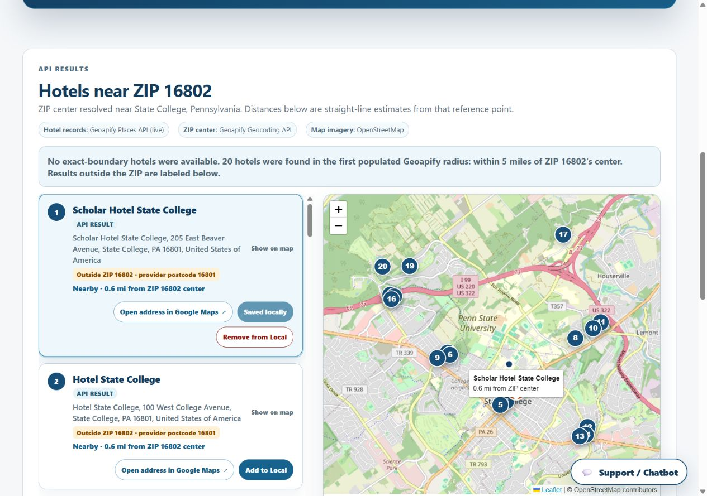
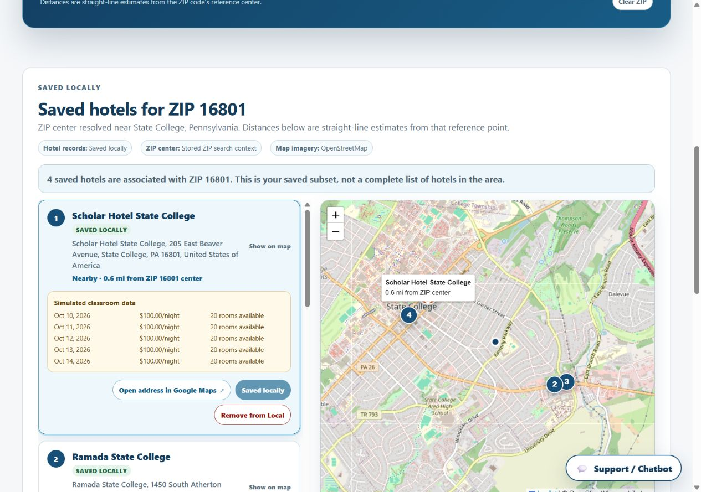
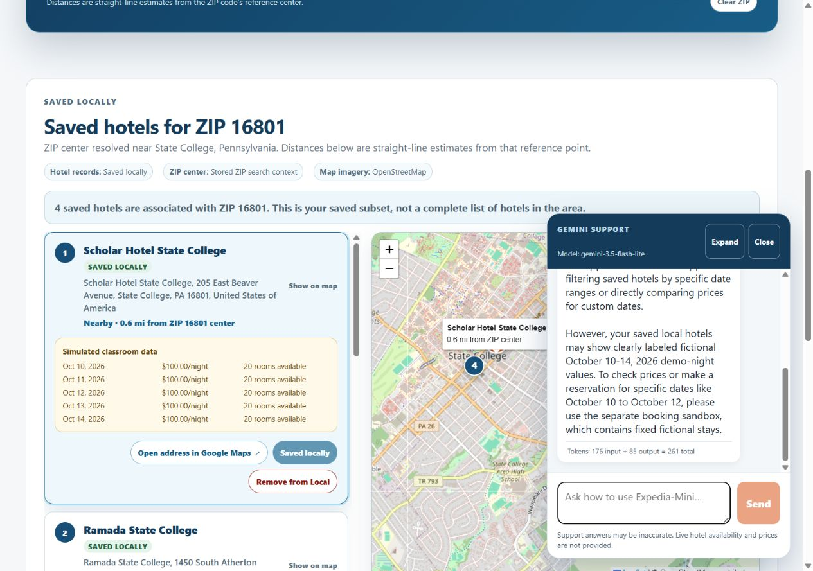
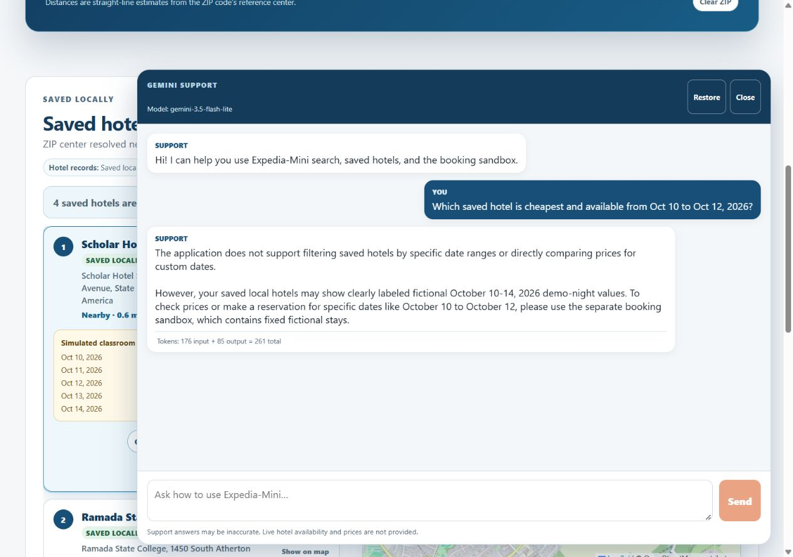
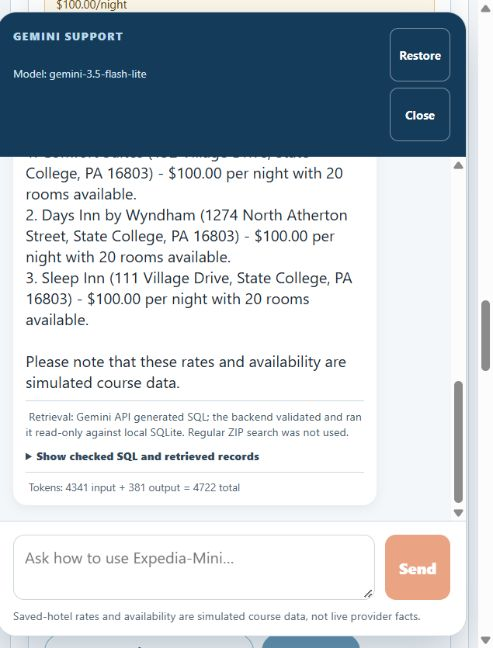
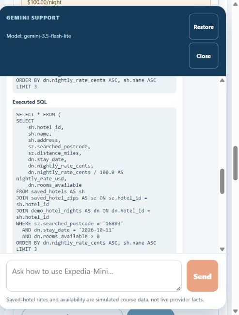

# Expedia-Mini Final Report

Last updated: October 13, 2026

## Project access

- Repository: [github.com/soumetsu/expedia-mini](https://github.com/soumetsu/expedia-mini)
- Assessed implementation branch: `rag_integration`
- Last published implementation commit: [`2643f66`](https://github.com/soumetsu/expedia-mini/commit/2643f66)
- Assessed SQL-grounded assistant implementation commit: `35e00b3` (local;
  pending push to GitHub).
- Backend setup: create or activate `backend/.venv`, install the pinned packages
  from `backend/requirements.txt` when needed, configure the project-root `.env`,
  then run from `backend/`:

  ```powershell
  .\.venv\Scripts\python.exe -m uvicorn app.main:app --host 127.0.0.1 --port 8000
  ```

- Frontend setup: install the packages declared in `frontend/package-lock.json`
  when needed, then run from `frontend/`:

  ```powershell
  npm run dev -- --host 127.0.0.1 --port 5173
  ```

The `.env` file and its Geoapify and Gemini credentials are local-only and must
not be committed. Full startup, endpoint, and configuration details are in
[README.md](README.md).

## What was added and changed

Expedia-Mini now combines a live hotel-discovery interface with a separate
fictional classroom booking workflow.

- A five-digit U.S. ZIP search resolves the ZIP through Geoapify and searches
  its boundary first, then the first populated 5-, 15-, or 30-mile radius.
- Live hotel cards and the Leaflet map share selection state and show provider
  place details, distance, search scope, and a Google Maps address link.
- Selected provider hotels can be saved to SQLite with their ZIP/search context.
  Saving is idempotent; removing a hotel transactionally removes only its local
  associations and fictional demo nights.
- Local saved results and live API results are labeled separately. Fictional
  October 10–14, 2026 rates and room counts are never presented as live data.
- The original classroom catalog supports deterministic recommendations,
  simulated booking creation, history, cancellation while retaining the record,
  and deletion of test bookings.
- Demo accounts use hashed passwords and process-local bearer sessions.
  Search history is persisted and filtered by the authenticated user.
- A bottom-right hotel chatbot opens as a compact desktop panel and can be
  expanded. Vue calls only FastAPI; the Gemini API key stays on the backend.
- The chatbot uses `gemini-3.5-flash-lite` as primary and a labeled
  `gemini-3.1-flash-lite` availability fallback, shows every model actually used
  in its header, and displays Gemini-reported input, output, and total token
  counts when supplied. It includes pending, sanitized error, retry, close,
  restore, keyboard, and narrow-screen states.
- Backend startup loads [hotel-assistant.md](prompts/hotel-assistant.md). The
  first Gemini call proposes SQL using the saved-hotel schema and query rules.
- The backend permits one bounded `SELECT` against only `saved_hotels`,
  `saved_hotel_zips`, and `demo_hotel_nights`, using a read-only connection,
  authorizer, progress timeout, and outer row limit.
- A second Gemini call receives the original question and checked rows. The
  frontend labels this SQL-backed path and exposes generated SQL, executed SQL,
  and retrieved records. A support-only path is labeled separately.
- `conversation_history` stores separate user/assistant rows;
  `conversation_traces` stores generated SQL, executed SQL, result summary, and
  error stages without mixing writes into the read-only hotel query.

The implementation preserves MVC boundaries: Pydantic/entity definitions are
under `backend/app/models/`, database and provider workflows are under
`backend/app/controllers/`, FastAPI routes remain HTTP adapters, and Vue owns
the view while `frontend/src/services/api.js` owns browser API requests.

## Research notes and design decisions

Sources consulted included the supplied CSV/data documentation, the existing
Expedia reference screenshots in `docs/`, Leaflet 1.9.4 documentation,
Geoapify API documentation, Vue 3 and FastAPI documentation, and the official
[Gemini Generate Content API reference](https://ai.google.dev/api/generate-content)
for response and token-usage metadata.

Useful observed patterns were ZIP-first hotel discovery, synchronized map/list
selection, a fixed help launcher, a compact desktop conversation window, and an
optional expanded chat view. Problematic or unsupported ideas included treating
nearby results as inside the requested ZIP, presenting fictional price or room
data as provider facts, exposing credentials to Vue, and allowing arbitrary
model-generated SQL. These observations produced the boundary-first/radius
fallback, explicit data-source labels, backend-only credentials, and a narrowly
allowlisted read-only SQL workflow instead of arbitrary model execution.

### Current Expedia search-results reference

The following Expedia captures were observed on October 13, 2026 for Times
Square, New York, October 13–15, 2026, two travelers, and one room. Prices,
availability, property counts, and rankings are live third-party observations
and may change; they are design research rather than application test data.





The results emphasize destination/date context, fast filters, rating and review
evidence, nightly and total prices, availability warnings, and a persistent map
action. The project borrows the information hierarchy, but continues to label
its fixed rates and availability as simulated course data.

## Early design evidence

The repository contains the early Expedia reference captures
[expediaFrontPage.png](docs/expediaFrontPage.png) and
[expediaFlights.png](docs/expediaFlights.png). The implemented design changed
into a smaller assignment-focused Vue interface with explicit live-versus-demo
labels, synchronized map/cards, and a compact support widget.

A separate pre-implementation wireframe or mockup was not saved in the
repository. That remains an evidence gap and should not be represented as
completed.

## Current implementation screenshots

The following October 13, 2026 captures record the baseline most likely to be
changed by the Part 2 RAG work.



The current home view separates live ZIP search from the fictional booking
sandbox and exposes the fixed support launcher.



ZIP `16802` returned 20 then-current Geoapify results in the first populated
5-mile radius. The view shows the synchronized map plus Add, saved, and Remove
states that must remain stable while RAG is added.



ZIP `16801` returned four locally saved hotels with clearly labeled simulated
October 10–14 rates and room availability. These rows are the intended SQL
retrieval foundation for Part 2.





These captures are the before state. The updated chatbot now exposes its
generated SQL, backend-executed bounded SQL, and retrieved records below a
grounded reply; an updated recorded demonstration is still required.





These October 13 captures show the successful final checkpoint. The answer
uses the requested night, three saved hotels, simulated prices and room counts,
and explicitly states that regular ZIP search was not used for the answer.

## Screen-recorded demonstration

- [API Hotel Search implementation recording](https://drive.google.com/file/d/1RE18yXONS_yBIjWmDBg6zdNJDlAgtJaS/view?usp=drive_link)

The existing link documents the Assignment 2.1 search work. A recording that
also covers the saved-hotel lifecycle and Gemini chatbot has not been linked and
remains a submission gap.

## Verification record

| Area | Input or action | Expected | Observed | Correction or limitation |
| --- | --- | --- | --- | --- |
| Backend regression | Run `python -m unittest discover -s tests -v` from `backend/` | All contracts and workflows pass | Latest rerun: 65 tests passed in 60.087 seconds on October 13, 2026 | No automated browser-component suite is configured |
| Frontend build | Run `npm run build` from `frontend/` | Production bundle builds | Latest rerun: 26 modules transformed successfully in 3.05 seconds on October 13, 2026 | Existing installed Node/Vite toolchain required |
| Live ZIP search | Search ZIP `16802` on October 13, 2026 | Local saved subset first; live fallback when empty | Empty local subset fell through to 20 then-current Geoapify records in the first populated 5-mile radius, with API labels and synchronized map | Geoapify results and counts can change |
| Saved-data baseline | Search ZIP `16801` on October 13, 2026 | Return saved hotels and labeled demo nights without a live fallback | Four saved hotels displayed October 10–14 simulated $100 nightly rows and 20 rooms per night | This is a saved subset, not full area inventory |
| Saved hotels | Add, refresh, and remove a provider hotel in temporary-database tests | Idempotent save, preserved edits, scoped transactional delete | Tests passed without changing Assignment 1 rows | Rates and rooms are explicitly fictional |
| Chat success | Submit `What can this app help me do?` | Browser calls `/api/chat`; response returns through FastAPI | HTTP 200 reply rendered with `160 input + 149 output = 309 total` provider-reported tokens | Token counts vary by conversation |
| SQL safety | Try `DELETE FROM saved_hotels`, an unapproved `users` read, and two statements | Reject before any database change | Automated tests rejected all three; valid hotel SQL ran through a read-only/query-only connection with authorizer, timeout, and 20-row outer cap | SQL validator intentionally supports focused `SELECT` statements only |
| RAG checkpoint | Ask for the three cheapest available saved hotels near ZIP `16803` for October 11, 2026 | First model call proposes the two JOINs; backend retrieves three rows; second call returns a grounded answer | Conversation `4b916c51-5786-4287-98bf-a07186874a5f` recorded both SQL stages and three rows; the UI displayed Comfort Suites, Days Inn by Wyndham, and Sleep Inn at simulated $100.00 with 20 rooms for the requested night | Earlier attempts produced sanitized 502 states and were retained as failure evidence; the final cooled-down retry succeeded |
| Chat provider load | Submit the ZIP `16803` RAG question after deploying backoff and labeled model fallback | Provider failures remain sanitized and bounded; either primary or fallback can complete both stages | An initial post-backoff retry returned sanitized 502 before SQL; after the fallback revision, conversation `b1ef1ec9-a215-4c32-83ce-2b9eb6acb47a` completed both stages with HTTP 200 on primary and reported 5,331 tokens | The fallback path is mocked and verified but was not needed by this successful live call |
| Secret boundary | Inspect request contract and mocked controller call | Browser request contains message/history only; key remains backend-side | Tests confirmed the key is sent only in the backend `x-goog-api-key` header and not the provider URL | Native browser Network-panel capture is not saved |
| Formatting | Run `git diff --check` | No whitespace errors | Passed; Git reported only LF/CRLF conversion notices | Line-ending notices are environment-specific |

Manual review also covered the applicable user-facing portions: local-first ZIP
behavior, saved/API labels, Add/Remove controls, refreshed results, synchronized
list/map selection, responsive layout, simulated-data disclosures, compact and
expanded chatbot modes, the model label, per-reply usage, the grounded answer,
and the expandable SQL/retrieved-row evidence.

The fixed labeled sample is
[hotel-assistant-16803.json](docs/fixtures/hotel-assistant-16803.json).
Repeatable checks use it alongside deterministic SQLite fixtures in
`backend/tests/test_database.py` and mocked two-stage provider payloads in
`backend/tests/test_chat.py`.

Detailed repeat instructions are in [docs/verification.md](docs/verification.md).

## AI disclosure and evidence log

- **OpenAI Codex, GPT-5:** repository inspection, focused edits, test execution,
  browser verification, documentation condensation, and Git preparation.
- **Google Gemini API, `gemini-3.5-flash-lite` primary and
  `gemini-3.1-flash-lite` availability fallback:** the selected runtime model is
  used first to propose focused SQL and again to answer from checked rows. The
  response identifies every model actually used. Neither model receives SQLite
  access or credentials or can execute or modify the database.

Selected prompt-to-change evidence:

- “Use the first LLM request to propose SQL ... send the original question and
  retrieved rows in a second LLM request” led to the staged controller in
  [chat.py](backend/app/controllers/chat.py), the allowlisted executor in
  [database.py](backend/app/controllers/database.py), and visible evidence in
  [ChatbotWidget.vue](frontend/src/components/ChatbotWidget.vue).
- “Use `prompts/hotel-assistant.md` and load it at backend startup” led to the
  versioned prompt and explicit lifespan load in [main.py](backend/app/main.py).
- “The frontend should call your application, with no API key included in the
  request” led to the `/api/chat` proxy contract and backend-only key header,
  verified in [test_chat.py](backend/tests/test_chat.py).
- “Add here: The model being used” led to the visible model label and optional
  provider-reported token metric in the chatbot component and response schema.
- A revised approach is recorded by the live Gemini 503 result. The first
  implementation surfaced a generic provider failure; it was revised to retry
  transient 429/5xx and network failures with capped exponential backoff,
  jitter, and a bounded `Retry-After` value. Continued 503s led to a second,
  tested revision: three primary attempts and two labeled fallback attempts for
  exhausted 5xx/network availability errors, while 429/authentication failures
  stay on the primary path. Failed messages remain omitted from later model
  history and frontend errors stay sanitized.
- During the RAG checkpoint, early answer-stage failures prompted a bounded
  revision from a 20-second timeout to 30 seconds. The later cooled-down browser
  attempt completed both model calls and retained the earlier errors in
  `conversation_traces`. Continued 503s then prompted the tested backoff policy
  above.

No full chat export is required. The linked source, tests, verification record,
and selected excerpts identify the material AI-assisted decisions and changes.

## Remaining limitations

Production authentication, payments, taxes and fees, live prices and room
inventory, ratings, reviews, amenities, transportation bundles, personalized
ranking, arbitrary availability, and real booking remain outside scope. Live
provider results may change, and Gemini can still return transient failures
even though the final two-call checkpoint succeeded. The early mockup and
expanded demo recording remain evidence gaps.
