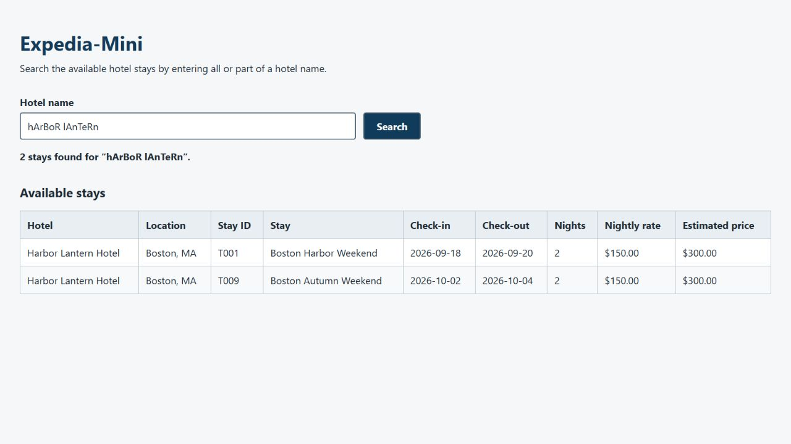
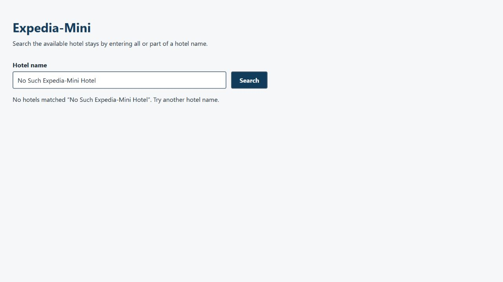
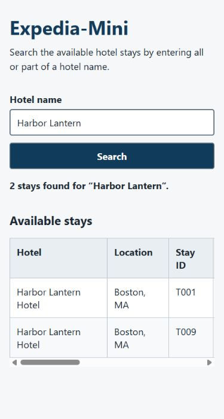

# Expedia-Mini — Part 1

## Repository and commit

- Repository: [github.com/soumetsu/expedia-mini](https://github.com/soumetsu/expedia-mini)
- Published Part 1 implementation commit:
  [`73fee4df1db360c8c8506f5df5b4d56dbdc060e0`](https://github.com/soumetsu/expedia-mini/commit/73fee4df1db360c8c8506f5df5b4d56dbdc060e0)

The persistence, MVC, and booking milestone described below was published to
`main` in commit `a49e4a8`.

## Implementation

Expedia-Mini is a responsive Vue 3 and FastAPI application for searching the
supplied fictional stays and managing simulated bookings. Search accepts a
city, state, or hotel name and optional check-in/check-out dates. Because the
source data describes fixed trips, the date fields narrow the existing catalog
rather than suggesting arbitrary room availability.

Search results now appear above the recommendation section as scannable cards
with stay dates, length, nightly price, estimated total, and a booking action.
The main location control remains visually primary; dates and the demo-user
selector are secondary. A separate `/bookings` page presents booking history,
confirmed/cancelled status, cancellation that retains the record, and a
two-step delete control for user-created test bookings. Seeded examples remain
protected from deletion.

The search form also provides a compact **Clear selections** action that resets
the active destination, optional dates, visible result cards, and transient
booking feedback without deleting persisted booking history.

SQLite persistence is implemented with Python's standard-library `sqlite3`.
The backend creates the schema and imports the unchanged hotel, trip, user, and
booking CSV rows once. Existing IDs are preserved, new bookings receive a
collision-free ID, and later restarts do not duplicate seeds or restore deleted
records. After the initial import, hotel search, recommendations, demo-user
reads, and booking CRUD all use SQLite. No SQLite package was installed.

The implementation follows MVC responsibilities. Typed entities and Pydantic
contracts are under `backend/app/models/`; SQLite and business controllers are
under `backend/app/controllers/`; Vue pages, components, and CSS form the View.
The suggested folders were placed inside the existing `app` package so the
architecture fits FastAPI's import structure. Thin routes call the controllers
through agreed typed contracts. All user-facing CRUD starts in Vue and travels
through `/api`; the browser never accesses SQLite directly.

Recommendations remain factual and deterministic: one stay per hotel ranked
by estimated total, nightly rate, check-in date, and trip ID. Recent-search
personalization is still explicitly identified as future work. Demo accounts
now support unique usernames, hashed passwords, optional unique emails, and a
process-local bearer session. Authenticated searches are stored in a per-user
`search_history` table and displayed on a separate page.

The backend now loads the project-root `.env` through `backend/app/config.py`
using the available `python-dotenv` package. `GET /api/health` preserves the
existing service status and reports only whether `GEOAPIFY_API_KEY` is
configured; it never returns the key value. The backend must be restarted after
editing `.env`.

The temporary ZIP demonstration has been replaced with live hotel discovery.
`backend/app/controllers/geocoding.py` resolves an exact U.S. postcode through
Geoapify Geocoding, then requests `accommodation.hotel` places inside the
resolved postcode `place_id` with proximity bias. The controller accepts only
finite coordinates and an exact matching returned postcode, deduplicates
provider records by normalized hotel name, calculates straight-line distance
from the ZIP reference center, and sorts nearest first. If that exact pass is
empty, it sends live Geoapify Places circle requests at 5, 15, then 30 miles
and stops at the first radius with usable records. Expanded results are checked
against the requested distance and carry the provider-postcode relationship,
selected radius, and explicit source metadata. The thin
`GET /api/hotels/nearby` route validates five-digit ZIPs and maps unresolved,
configuration, and provider outcomes to sanitized 404, 503, and 502 responses.
A successful search with no hotels through the 30-mile fallback remains HTTP
200 with an empty result list. The former `/api/demo/zip-location` route is
removed.

The main Vue search no longer queries the fictional CSV/SQLite catalog.
`HotelSearchForm.vue` accepts ZIP codes only, `NearbyHotelList.vue` presents
provider-supported names, addresses, and distances, and `HotelMap.vue` renders
the same records with Leaflet 1.9.4 and OpenStreetMap tiles. Both views share
Geoapify `place_id` selection state: choosing a card focuses its marker and
tooltip, while choosing a marker highlights and focuses the card. The
blue/cyan live-search treatment is visually distinct from the old search.
The result panel names Geoapify Places, Geoapify Geocoding, and OpenStreetMap;
expanded results show their applied radius and postcode relationship. Distance
text is blue through 5 miles, orange above 5 through 15 miles, and red above
15 miles, with textual Nearby/Far/Very far labels so color is not the only cue. The
fictional catalog remains separately labeled as a booking sandbox so every
required booking lifecycle action stays available without making live-hotel
availability or booking claims. No frontend Geoapify key or `VITE_` secret was
added.

Each live result card now separates two semantic actions: a button selects the
matching Leaflet marker, while an external link opens a keyless Google Maps
search in a new tab. The query uses the Geoapify-formatted address when present
and the provider coordinates otherwise. The link uses `noopener noreferrer`;
Google's eventual match remains external behavior and is not treated as a
verified booking or provider record.

## Verification

The following checks were completed with automated commands and browser
control; they do not represent manual user or developer review.

- The pre-change baseline passed all 43 backend tests and the Vue production
  build with 19 modules transformed.
- Leaflet 1.9.4 was installed from npm after explicit user approval. npm audited
  37 packages and reported zero vulnerabilities.
- The focused live-search suite passed 19 tests after adding mocked boundary,
  5-mile, 15-mile, and exhausted-30-mile coverage. The final full backend suite
  passed 47 tests in 19.040 seconds.
- The final Vue production build passed with 25 modules transformed, producing
  the Leaflet-inclusive bundle without build errors.
- Live HTTP verification reported configured-key health without exposing the
  key, returned 422 for an invalid ZIP, and returned 404 for the removed demo
  route.
- A live `16802` request found 20 current Geoapify Places records in the first
  populated 5-mile fallback; the nearest was 0.60 miles from the ZIP center and
  the returned postcodes were honestly labeled as adjacent. A live `10036`
  request stayed in exact-boundary mode and returned 16 normalized records.
  Provider counts can change.
- Browser verification at the narrow app viewport confirmed the explicit live
  source list, 5-mile fallback explanation, outside-ZIP labels, blue Nearby
  distance treatment, OpenStreetMap-attributed Leaflet map, list-to-marker
  focus, marker-to-card focus, and no console warnings or errors.
- The Google Maps card-action update passed the Vue production build with 25
  modules. Browser inspection for ZIP `22150` confirmed separate map-selection
  and external-link controls, a URL-encoded Geoapify address query,
  `target="_blank"`, `rel="noopener noreferrer"`, and readable narrow-layout
  styling. The in-app browser did not expose the external tab after automated
  activation, so the new-tab destination was verified from the rendered link
  contract rather than claimed as an observed Google page load.

- The intended `backend/.venv` interpreter reported Python 3.13.15 and SQLite
  3.50.4. SQLite support was already present, so installation was skipped.
- All 25 backend `unittest` tests passed, including all-four-file model and
  relationship validation, one-time seeding,
  collision-free creation, history/read, cancellation retention, test-booking
  deletion, seed protection, date filtering, search, recommendations, and
  route registration, and proof that search reflects a post-seed SQLite change
  rather than rereading CSV.
- The Vue production build passed with 19 modules transformed after adding the
  account and search-history pages. No frontend
  lint or automated frontend test script is configured.
- Browser verification on the local application selected Demo Traveler 6,
  searched New York with a date window, and returned T003 and T004 above the
  recommendation cards.
- The browser created B007 for T003, displayed it on the separate history page,
  changed its status from confirmed to cancelled while retaining it, and
  displayed the two-step delete confirmation. The exact temporary B007 record
  was then deleted through the API for cleanup, and U006 history returned an
  empty list.
- The production build was rerun after the final display-name/status correction
  and passed. Both development servers remained reachable afterward.
- A browser check submitted a Boston search, activated **Clear selections**,
  and confirmed the location/date fields and four result cards were cleared
  while the recommendation cards remained.
- The focused authentication suite passed four tests for hashed-password
  verification, unique username/email conflicts, malformed-email rejection,
  and isolation between two users. The full backend suite then passed 29 tests.
- Browser verification signed in as the migrated `demo_u001` account, recorded
  a Boston search, displayed it on `/search-history`, and confirmed the
  registration page exposes username, password, confirmation, and optional
  email fields. The synthetic history row was removed after verification.
- The focused configuration and health suite passed 9 tests, including explicit
  project-root path derivation and absent, empty, whitespace-only, and non-blank
  key handling without exposing the key value.
- The focused Geoapify controller suite passed 14 tests total with mocked
  success, mismatched-location, invalid-coordinate, missing-configuration, and
  provider-failure behavior; those tests made no live provider request.
- After restarting the identified backend listener, the live local route
  returned HTTP 200 with the sanitized `16802` location response: country code
  `us`, locality State College, and usable coordinates.
- The configured frontend production build passed with 19 modules transformed.
  The documented Vite dev server was started on port 5173 for browser
  inspection.
- Browser review requested a table layout for the location result. The panel
  now renders the available sanitized fields in labeled table columns, with
  horizontal scrolling for narrow viewports; the frontend build passed again.
- Browser review exposed a stale backend process that predated the query
  parameter change. After restarting only that backend, a live `20176` request
  returned postcode `20176` and Leesburg locality, confirming the input-driven
  lookup now reaches the provider with the entered ZIP.
- Git publication verification confirmed `main` pushed successfully to
  `origin/main` at implementation commit `a49e4a8`.

### Existing automated browser evidence

## Project context and next steps

The [README](README.md) contains run commands, endpoints, current behavior, and
data boundaries. [docs/design.md](docs/design.md) records the architecture, and
[docs/verification.md](docs/verification.md) provides repeatable checks.

Production-grade authentication, password reset, payments, arbitrary
availability, rooms, occupancy, amenities, reviews, taxes, live demand,
transportation bundles, and dynamic pricing are outside the current
implementation. The demo authentication/session and per-user search-history
layer are implemented; battery state and device type must not affect price.
